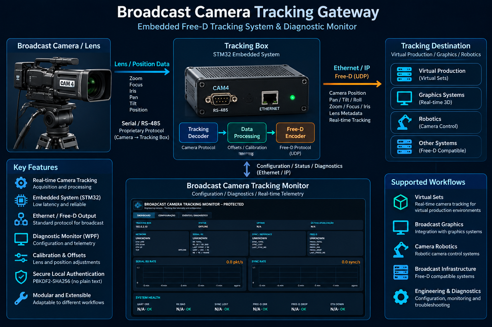
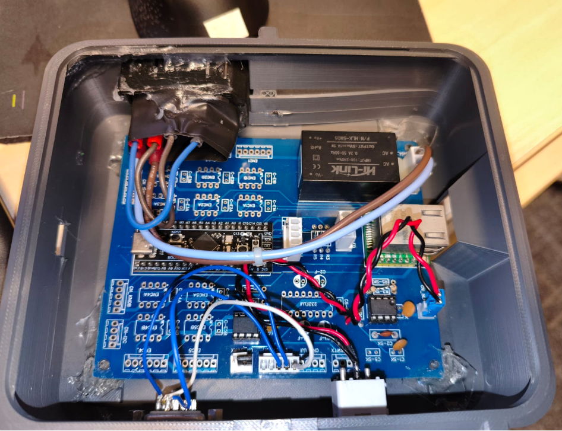
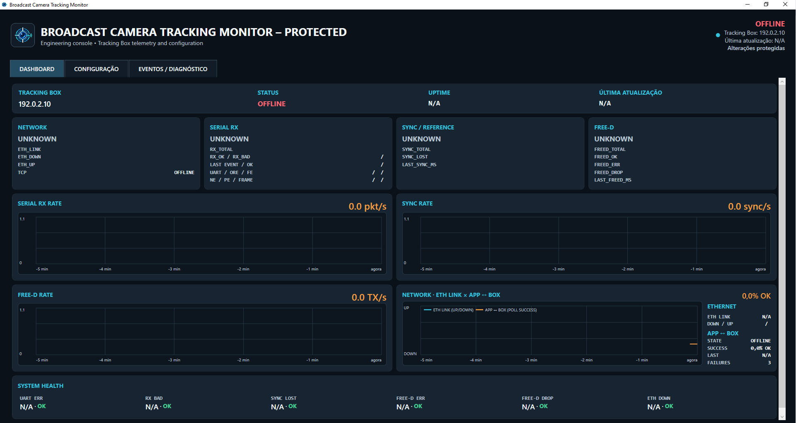

# Broadcast Camera Tracking Gateway

**Embedded Free-D Tracking System & Diagnostic Monitor**

An engineering portfolio project combining embedded systems, broadcast engineering, camera tracking, serial communication, Ethernet transport, Free-D output, and a desktop application for configuration, monitoring, telemetry, and diagnostics.

*System architecture — camera/lens data acquisition, embedded processing, Free-D output and diagnostic monitoring.*

## Overview

The project addresses the conversion of camera and lens tracking data into information usable by broadcast systems. A microcontroller-based Tracking Box acquires serial data, decodes and normalizes it, applies configurable processing and calibration, generates Free-D packets, and transmits them over Ethernet.

A companion desktop application provides configuration, telemetry, diagnostics, health visualization, and connection monitoring. This repository presents a sanitized, laboratory-tested functional prototype as an engineering portfolio project.

## Engineering Problem

The system brings together several practical engineering concerns:

- reliable serial and RS-485 data acquisition;
- decoding camera and lens tracking packets;
- normalization, coordinate transformation, and calibration;
- deterministic processing on embedded hardware;
- Free-D packet generation;
- Ethernet transport through a dedicated controller;
- persistent configuration and runtime diagnostics;
- recovery logic and health monitoring across serial, synchronization, network, and application layers.

## System Architecture

The primary tracking path is:

**Camera / Lens → Serial / RS-485 → STM32 Tracking Box → Tracking Decoder → Data Processing / Calibration → Free-D Encoder → Ethernet → Tracking Destination**

The supervisory path is:

**Tracking Monitor ↔ Configuration / Diagnostics ↔ Tracking Box**

The embedded and desktop components are separated so that real-time acquisition and protocol conversion remain in the Tracking Box while visualization and engineering controls remain in the Monitor. A more detailed description is available in [docs/architecture.md](docs/architecture.md).

## Hardware Prototype

*Tracking Box hardware prototype used during development and validation.*

The prototype integrates:

- STM32-based embedded processing;
- a serial interface for camera and lens tracking input;
- an Ethernet interface using a W5500 controller;
- tracking data decoding and transformation;
- Free-D packet output;
- configuration and diagnostic communication.

The image documents the development prototype without identifying an installation or operational environment.

## Diagnostic Monitor

*Sanitized diagnostic interface using RFC 5737 documentation addresses.*

The WPF desktop application provides:

- Tracking Box online/offline status;
- Ethernet link and application-connection status;
- Serial RX activity and error monitoring;
- synchronization/reference monitoring;
- Free-D transmission status;
- telemetry counters and rate graphs;
- health indicators and event history;
- configuration and diagnostic operations;
- protected local configuration using password-based authorization.

## Firmware

The firmware targets an STM32F401 Cortex-M4 MCU. Its high-level structure includes peripheral initialization, serial reception, tracking packet decoding, coordinate processing, synthetic calibration maps, Free-D encoding, W5500 Ethernet transport, emulated EEPROM configuration, watchdog handling, and runtime diagnostics.

The public network defaults use documentation-only addresses. Installation-specific dimensions, offsets, coordinates, and calibration tables were removed and replaced with clearly synthetic examples. Vendor HAL, CMSIS, WIZnet, and middleware sources are not redistributed as part of this portfolio snapshot.

## Tracking Monitor

The desktop monitor is implemented in C# with .NET 8 and WPF. It separates models, parsers, services, view models, views, diagnostics, logging, and visualization controls. Communication services handle configuration commands and diagnostic polling, while the UI exposes state without embedding operational infrastructure data.

Local maintenance authorization uses PBKDF2-SHA256, a random salt, and a locally stored hash under the user's application-data directory. No default or operational credential is included.

## Security & Public Sanitization

- All displayed example IP addresses belong to RFC 5737 documentation ranges.
- Public calibration values and maps are synthetic.
- Operational logs and diagnostic captures are excluded.
- Local credentials and authentication files are not versioned.
- Compiled binaries, build outputs, symbols, archives, and backups are excluded.
- Installation-specific configuration and infrastructure identifiers were removed.

See [docs/security.md](docs/security.md) for the publication policy and sanitization boundaries.

## Testing & Validation

The Monitor test application passed its available automated checks using loopback networking, synthetic protocol payloads, and temporary authentication data. Validated categories include:

- authentication hashing and salt handling;
- password creation and replacement behavior;
- connection recovery and online/offline state transitions;
- telemetry and configuration parsing;
- TCP timing and diagnostic classification;
- synthetic network configuration;
- Free-D destination parsing;
- axis inversions and offsets;
- polling concurrency and retry behavior.

The public firmware snapshot was not compiled as part of the sanitization process because third-party vendor dependencies were intentionally excluded from this portfolio tree.

## Technology Stack

| Area | Technologies and topics |
|---|---|
| Embedded | STM32F401, Cortex-M4, C/C++, Serial / RS-485, Ethernet, W5500, Free-D |
| Desktop | C#, .NET 8, WPF |
| Engineering | Tracking data processing, telemetry, diagnostics, calibration, persistent configuration, network communication |
| Security | PBKDF2-SHA256, random salts, local credential storage, publication sanitization |

## Repository Structure

    firmware/                Sanitized embedded firmware source
    monitor/                 WPF diagnostic monitor and automated tests
    docs/                    Architecture and security documentation
    docs/imagens/            Sanitized portfolio images
    images/                  Reserved for future public assets
    config-examples/         Synthetic documentation-only calibration
    README.md                Project presentation
    THIRD_PARTY_NOTICES.md   External dependency categories and notices
    .gitignore               Publication and build exclusions

## Third-Party Components

The firmware depends on vendor and protocol components that are not redistributed in full in this portfolio version, including STM32Cube HAL/CMSIS, WIZnet ioLibrary/W5500 support, applicable middleware, and Free-D specifications. The desktop project also relies on the .NET ecosystem.

These components remain subject to their respective licenses and terms. See [THIRD_PARTY_NOTICES.md](THIRD_PARTY_NOTICES.md).

## Roadmap

- Improve build and architecture documentation.
- Expand automated validation for isolated firmware logic.
- Create fully reproducible public firmware build instructions.
- Increase protocol abstraction between acquisition, processing, and transport.
- Add further diagnostic and observability tooling.

## Disclaimer

This repository represents a sanitized engineering and portfolio version of the project.

It does not contain production network information, installation-specific calibration, operational logs, credentials, or internal infrastructure data. It is presented as a functional prototype and laboratory-tested system, not as a turnkey commercial or safety-critical product.

## Rights and Usage

Copyright © 2026 Paulo Abel Pereira Alves.
All rights reserved.

This repository is publicly available for portfolio, demonstration and professional evaluation purposes.

No open-source license is granted.

Commercial use, redistribution, modification for redistribution, or incorporation into commercial products requires prior authorization from the author.

Commercial licensing or other arrangements may be discussed directly with the author.

Third-party components remain subject to their respective licenses and terms.

## Author

**Paulo Abel Pereira Alves**

Telecommunications Engineering | Broadcast Engineering | Embedded Systems | Python / AI

---

# Português

## Visão Geral

O **Broadcast Camera Tracking Gateway** é um projeto de engenharia para aquisição, processamento, conversão, transmissão e monitoração de dados de tracking de câmera em fluxos broadcast. Ele combina uma Tracking Box baseada em STM32 com um aplicativo desktop em C#/.NET 8 e WPF para configuração, telemetria e diagnóstico.

*Arquitetura do sistema — aquisição de dados de câmera/lente, processamento embarcado, saída Free-D e monitoração de diagnóstico.*

## Problema de Engenharia

O sistema trata aquisição serial/RS-485, decodificação de dados de câmera e lente, normalização, transformação de coordenadas, calibração, processamento embarcado determinístico, geração Free-D, transporte Ethernet, configuração persistente, recuperação de comunicação e monitoração de saúde.

## Arquitetura

O fluxo principal é:

**Câmera / Lente → Serial / RS-485 → Tracking Box STM32 → Decoder → Processamento / Calibração → Encoder Free-D → Ethernet → Destino de Tracking**

O Monitor se comunica bidirecionalmente com a Tracking Box para configuração e diagnóstico. Consulte [docs/architecture.md](docs/architecture.md).

## Protótipo de Hardware

*Protótipo de hardware da Tracking Box utilizado durante desenvolvimento e validação.*

O protótipo reúne processamento STM32, entrada serial, interface Ethernet/W5500, transformação de tracking, saída Free-D e comunicação de diagnóstico, sem identificar instalação ou ambiente operacional.

## Monitor de Diagnóstico

*Interface de diagnóstico sanitizada usando endereços reservados para documentação pela RFC 5737.*

O Monitor apresenta estados online/offline, link Ethernet, recepção serial, sincronismo, transmissão Free-D, telemetria, gráficos de taxa, indicadores de saúde, eventos, configuração e operações protegidas por autenticação local.

## Tecnologias

| Área | Tecnologias |
|---|---|
| Embarcado | STM32F401, Cortex-M4, C/C++, Serial / RS-485, Ethernet, W5500, Free-D |
| Desktop | C#, .NET 8, WPF |
| Engenharia | Processamento de tracking, telemetria, diagnóstico, calibração e comunicação de rede |
| Segurança | PBKDF2-SHA256, salt aleatório e armazenamento local de hash |

## Testes e Validação

Os testes disponíveis do Monitor passaram utilizando loopback, payloads sintéticos e dados temporários de autenticação. Foram exercitados hashing de autenticação, recuperação de conexão, estados online/offline, parsing de telemetria, diagnóstico TCP, configuração sintética de rede, destinos Free-D, inversões, offsets e comportamento do polling.

O snapshot público do firmware não foi compilado durante a sanitização, pois dependências externas de fornecedores foram deliberadamente excluídas desta árvore de portfólio.

## Segurança da Versão Pública

Os IPs exibidos pertencem a faixas RFC 5737. Calibrações públicas são sintéticas; logs operacionais, credenciais locais, binários, builds, backups e dados específicos de instalação não fazem parte do repositório. Consulte [docs/security.md](docs/security.md).

## Roadmap

- Melhorar a documentação técnica e de build.
- Expandir a validação automatizada.
- Criar instruções reproduzíveis para o build público do firmware.
- Ampliar a abstração dos protocolos.
- Adicionar novas ferramentas de diagnóstico.

## Direitos e Uso

Copyright © 2026 Paulo Abel Pereira Alves.
Todos os direitos reservados.

Este repositório é disponibilizado publicamente para fins de portfólio, demonstração e avaliação profissional.

Nenhuma licença open-source é concedida.

Uso comercial, redistribuição, modificação para redistribuição ou incorporação em produtos comerciais requer autorização prévia do autor.

Licenciamento comercial ou outros acordos podem ser discutidos diretamente com o autor.

Componentes de terceiros permanecem sujeitos às respectivas licenças e termos.

## Autor

**Paulo Abel Pereira Alves**

Telecommunications Engineering | Broadcast Engineering | Embedded Systems | Python / AI
